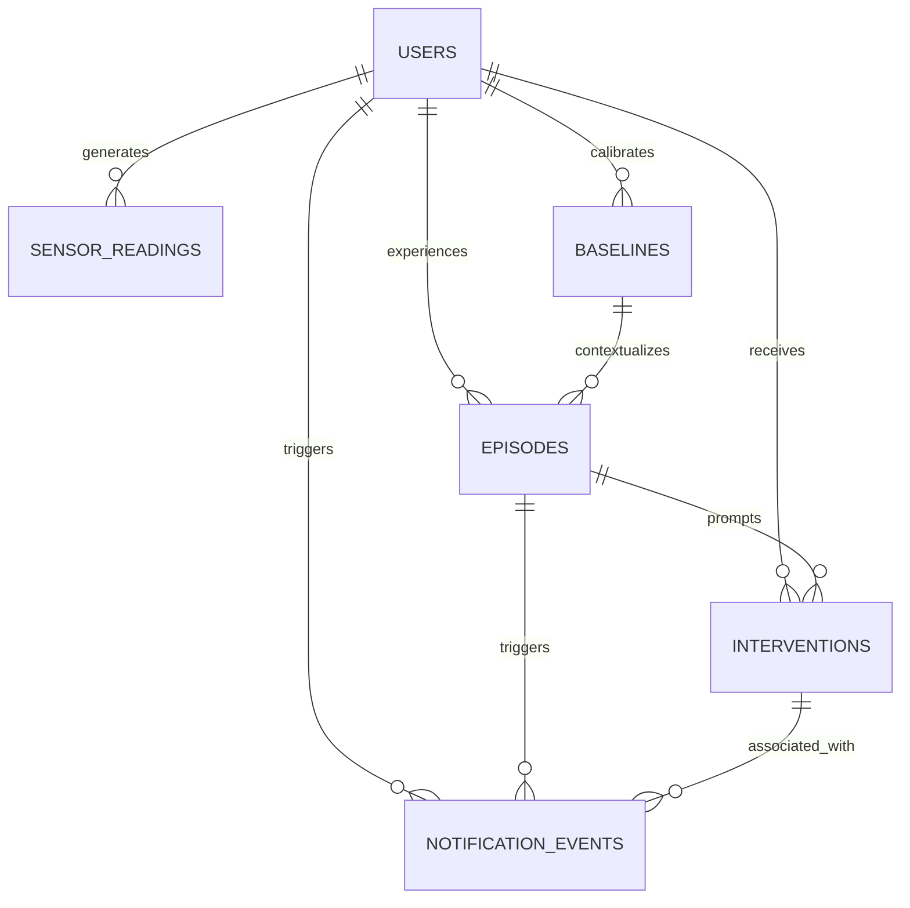

# MindEase-AI

> Autonomous Stress & Anxiety Telemetry, Intervention, and Support Platform

MindEase-AI is an intelligent platform designed to continuously track multi-modal physiological telemetry (heart rate, electrodermal activity, skin temperature, respiratory rate), calibrate patient baselines, detect acute stress/anxiety/panic episodes, prompt targeted micro-interventions (box breathing, grounding 5-4-3-2-1), and dispatch timely support alerts.

---

## Database Layer Architecture

The database layer is implemented under `Backend/` using modern **SQLAlchemy 2.x**, **SQLite**, **Alembic**, and **Pydantic v2**.

### Entity Relationship Model



### Models & Schema Specifications

1. **`users`**:
   - `id`: UUID (String 36, primary key)
   - `email`, `username`: Unique, indexed
   - `full_name`, `hashed_password`, `is_active`
   - `emergency_contact_name`, `emergency_contact_phone`, `emergency_contact_email`
   - Timestamps: `created_at`, `updated_at` (UTC)
   - Cascading deletes to all dependent telemetry and events

2. **`sensor_readings`**:
   - `id`: Autoincrement integer primary key
   - `user_id`: Foreign key (`users.id`, CASCADE)
   - `timestamp`: UTC indexed timestamp
   - **Telemetry Metrics**: `heart_rate`, `eda` (electrodermal activity / galvanic skin response), `skin_temperature`, `blood_oxygen`, `respiratory_rate`, `step_count`
   - **Missing Sensor Policy**: Missing sensor readings are stored as **SQL `NULL`** rather than coerced to zero (e.g. optical HR sensor disconnections or electrode dropouts never report as 0 BPM).
   - Constraints & Indexes: Composite index `(user_id, timestamp)` for high-throughput time-series queries.

3. **`baselines`**:
   - `id`: Autoincrement integer primary key
   - `user_id`: Foreign key (`users.id`, CASCADE)
   - Calibrated resting metrics: `baseline_heart_rate`, `baseline_eda`, `baseline_skin_temp`, `baseline_respiratory_rate`
   - Observation window: `window_start`, `window_end` (UTC)
   - `is_active`: Boolean flag indicating current baseline profile

4. **`episodes`**:
   - `id`: Autoincrement integer primary key
   - `user_id`: Foreign key (`users.id`, CASCADE)
   - `baseline_id`: Foreign key (`baselines.id`, SET NULL)
   - `start_time`, `end_time` (UTC)
   - `peak_severity`: Float scale 0.0 to 10.0
   - `episode_type`: `stress`, `anxiety`, `panic_attack`
   - `status`: `ongoing`, `resolved`, `dismissed`
   - `trigger_description`, `resolution_notes`

5. **`interventions`**:
   - `id`: Autoincrement integer primary key
   - `user_id`: Foreign key (`users.id`, CASCADE)
   - `episode_id`: Foreign key (`episodes.id`, SET NULL)
   - `intervention_type`: `box_breathing`, `grounding_54321`, `mindful_pause`, `guided_audio`, `emergency_call`
   - `status`: `suggested`, `accepted`, `in_progress`, `completed`, `skipped`, `rejected`
   - `duration_seconds`: Tracked intervention elapsed time
   - `user_feedback_rating`: 1 to 5 satisfaction rating

6. **`notification_events`**:
   - `id`: Autoincrement integer primary key
   - `user_id`: Foreign key (`users.id`, CASCADE)
   - `recipient`, `notification_channel` (`in_app`, `sms`, `email`, `push`), `notification_type`
   - **Simulation Policy**: All notifications initialize with `is_simulated = True` and `status = "simulated"`. Records can only be transitioned to real delivery (`is_simulated = False`, `status = "delivered"`) when a verified third-party provider confirms transmission.

---

## Directory Structure

```
MindEase-AI/
├── .gitignore
├── alembic.ini                   # Root Alembic configuration
├── readme.md                     # Project documentation
├── Backend/
│   ├── .env.example              # Environment configuration template
│   ├── alembic.ini               # Backend-local Alembic configuration
│   ├── config.py                 # Application & DB settings
│   ├── database.py               # Engine, Base, session maker, get_db, UTCDateTime
│   ├── main.py                   # FastAPI REST API entrypoint
│   ├── requirements.txt          # Production & testing dependencies
│   ├── alembic/                  # Database migration package
│   │   ├── env.py                # Alembic environment linked to Base.metadata
│   │   ├── script.py.mako        # Migration script template
│   │   └── versions/             # Migration revisions
│   ├── models/                   # SQLAlchemy 2.x declarative models
│   │   ├── user.py
│   │   ├── sensor_reading.py
│   │   ├── baseline.py
│   │   ├── episode.py
│   │   ├── intervention.py
│   │   └── notification_event.py
│   ├── schemas/                  # Pydantic v2 schemas
│   │   ├── user.py
│   │   ├── sensor_reading.py
│   │   ├── baseline.py
│   │   ├── episode.py
│   │   ├── intervention.py
│   │   └── notification_event.py
│   ├── repositories/             # Database access CRUD functions
│   │   ├── user_repo.py
│   │   ├── sensor_reading_repo.py
│   │   ├── baseline_repo.py
│   │   ├── episode_repo.py
│   │   ├── intervention_repo.py
│   │   └── notification_repo.py
│   ├── scripts/
│   │   └── seed_db.py            # Synthetic demo user & telemetry seeder
│   └── tests/                    # Pytest test suite with isolated SQLite DB
│       ├── conftest.py
│       ├── test_api.py
│       ├── test_migrations.py
│       ├── test_models.py
│       ├── test_notifications.py
│       ├── test_repositories.py
│       ├── test_seed.py
│       ├── test_sensor_readings.py
│       └── test_utc_timestamps.py
├── frontend/                     # Web interface
├── ai_chatbot/                   # Chatbot service
├── emergency/                    # Emergency service module
└── mood-tracker/                 # Mood tracking module
```

---

## Setup & Quickstart

### 1. Install Dependencies
```bash
pip install -r Backend/requirements.txt
```

### 2. Environment Configuration
Copy `.env.example` to `Backend/.env` (or configure system environment variables):
```bash
cp Backend/.env.example Backend/.env
```
Default connection string:
```
DATABASE_URL=sqlite:///./mindease.db
```

### 3. Run Database Migrations
Apply the initial schema using Alembic:
```bash
alembic upgrade head
```

To rollback:
```bash
alembic downgrade base
```

### 4. Seed Synthetic Demo Data
Run the idempotent seed script to create a synthetic user and sample time-series data:
```bash
python Backend/scripts/seed_db.py
```
This generates:
- Synthetic Demo User: `demo.synthetic@mindease.ai`
- Calibrated physiological baseline
- 5 time-series sensor samples (including deliberate `NULL` telemetry to verify missing value handling)
- 1 acute stress episode
- 1 completed box breathing intervention
- 2 notification alerts marked `is_simulated = True`

### 5. Run Automated Tests
Run the automated pytest test suite using an isolated SQLite database:
```bash
pytest -v Backend/tests
```

### 6. Start the API Server
Launch the FastAPI development server:
```bash
uvicorn Backend.main:app --reload --port 8000
```
Interactive Swagger documentation will be available at:
`http://localhost:8000/docs`
